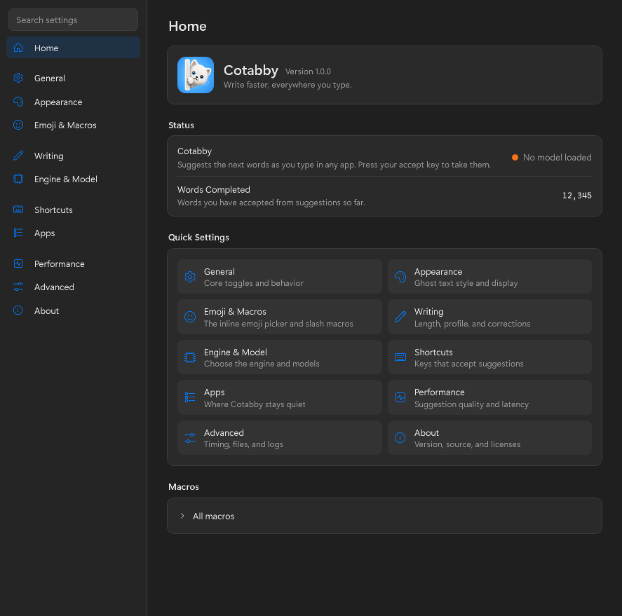
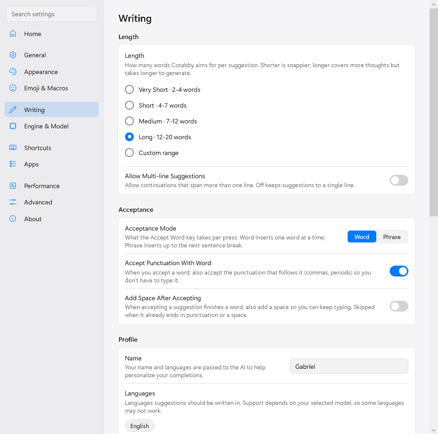
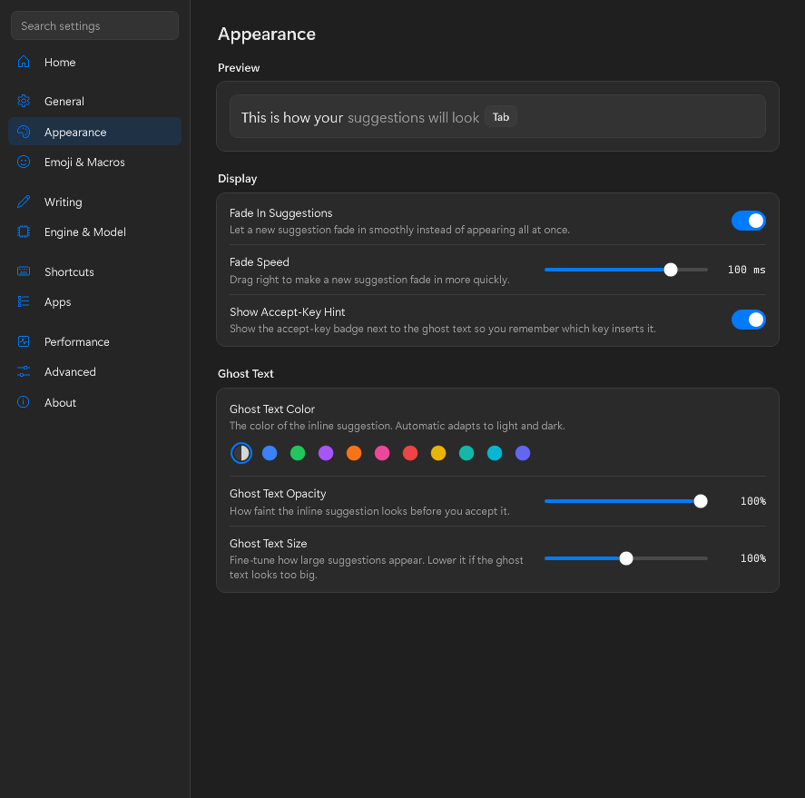
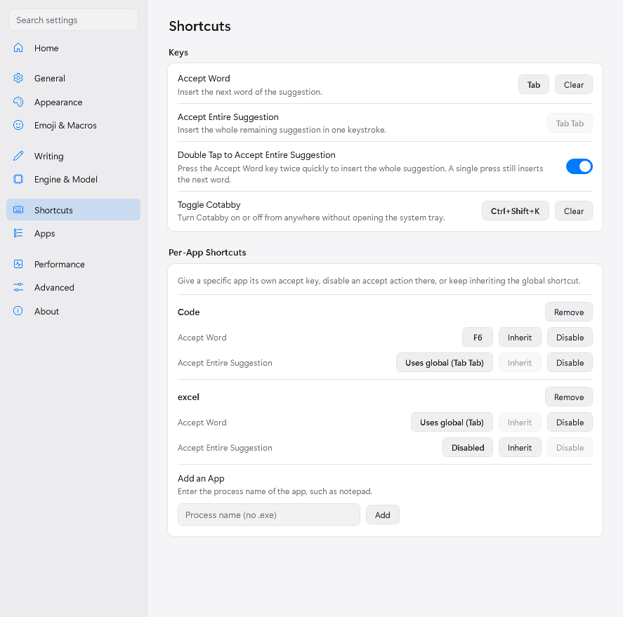
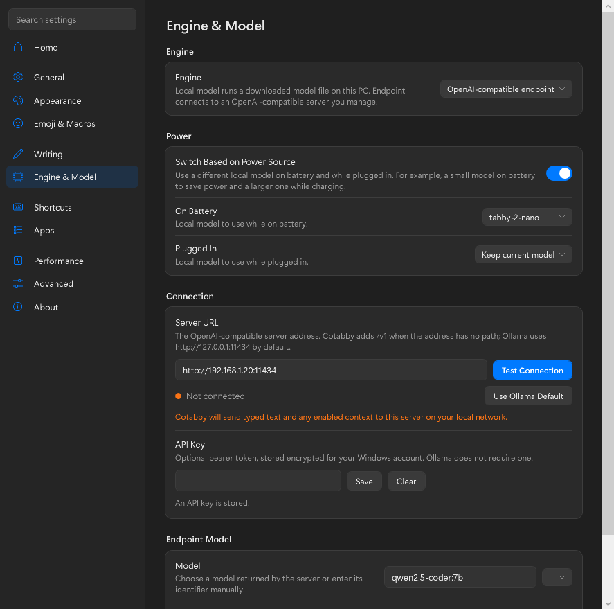
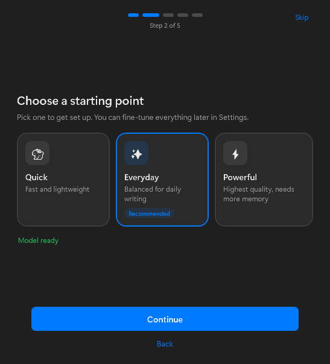
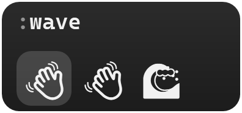

<p align="center">
  
</p>

<h1 align="center">Cotabby for Windows</h1>

<p align="center"><em>Open-source, local-first AI autocomplete for Windows.</em></p>

<p align="center">
  <a href="LICENSE"></a>
  
  
</p>

<p align="center">
  <sub>A native Windows port of <a href="https://github.com/FuJacob/cotabby">Cotabby</a>, the macOS app by FuJacob and contributors. This port tracks upstream v0.6.2.</sub>
</p>

---

## What It Does

Cotabby adds AI autocomplete to almost any text field on your PC. As you type, a gray suggestion appears next to your cursor. Press `Tab` to accept it a word at a time, or keep typing to ignore it.

The default engine runs a small model on your own machine. No account and no telemetry. An optional OpenAI-compatible engine can connect to a server you configure.

<p align="center">
  
</p>

## Features

- **Ghost-text autocomplete** in any text field that Windows UI Automation can read. Notepad, browsers, Slack, Outlook, VS Code and most other apps work.
- **Emoji autocomplete**. Type `:wave` and pick with `Tab`, the arrow keys or a closing colon.
- **Inline macros**. Type `/` for quick math, unit and currency conversion, dates and random values.
- **One-key autocorrect**. A misspelled word shows its fix in green and one keypress applies it.
- **Prediction controls**. Choose the suggestion length, whether to suggest inside a word, and whether suggestions may span lines.
- **Optional context**. Your name, your languages, notes about you, the app you are in and text you just copied can all inform a suggestion. Each one has its own switch.
- **Rebindable shortcuts** with per-app overrides, a double tap to accept everything, and a global on/off key.
- **Pause when you want**. Pause for a while from the tray, turn Cotabby off in specific apps, or let battery saver pause it for you.

<div align="center">

|  |  |
|:---:|:---:|
|  |  |
|  |  |

</div>

<p align="center">
  
  &nbsp;&nbsp;
  
</p>

## Privacy

Privacy is the whole point, so the default engine keeps generation on your PC.

- The local engine runs entirely on your machine.
- The optional OpenAI-compatible engine sends a bounded request only to the endpoint you configure. That endpoint can be on this PC, on your local network, or a public HTTPS service. Text after your cursor is never sent to it.
- No analytics, no telemetry, no crash reporting.
- A normal install never writes what you type to disk. The log records timings and counts. Verbose logging that includes text is opt-in through the `COTABBY_DEBUG_LOG=1` environment variable.
- Cotabby stays out of password fields, sign-in and verification fields, and terminals.
- Apart from a configured endpoint, the network is only used to download models.

## Engines

Choose the engine in Settings, Engine & Model.

- **Local model**. A small model you download once that runs on your PC through [llama.cpp](https://github.com/ggerganov/llama.cpp). It uses your GPU through Vulkan when one is available and falls back to the CPU.
- **OpenAI-compatible**. A completion or chat endpoint you configure, such as a local Ollama server, another machine on your network, or a public HTTPS service. The API key is stored encrypted for your Windows account.

| Model          | Size    | Good for                              |
| -------------- | ------- | ------------------------------------- |
| `tabby-2-nano` | ~0.6 GB | Older or low-memory PCs. Fastest.     |
| `tabby-2-mini` | ~1.3 GB | A solid everyday balance. The default |
| `tabby-2-base` | ~3.9 GB | Higher-quality suggestions            |
| `tabby-2-pro`  | ~5.3 GB | Best quality                          |

Cotabby can also switch between two local models depending on whether the PC is plugged in.

<details>
<summary><strong>Advanced</strong> model files, your own models, and how generation works</summary>

<br />

The local engine runs GGUF *base* models. Instead of prompting an instruction-tuned chat model, Cotabby treats the model as a pure text continuer and conditions it on your name, your languages and the surrounding context. These are the same files the macOS app uses.

| Model          | File                             | Source |
| -------------- | -------------------------------- | ------ |
| `tabby-2-nano` | `Qwen3.5-0.8B-Base.i1-Q6_K.gguf` | [Hugging Face](https://huggingface.co/mradermacher/Qwen3.5-0.8B-Base-i1-GGUF) |
| `tabby-2-mini` | `Qwen3.5-2B-Base.i1-Q4_K_M.gguf` | [Hugging Face](https://huggingface.co/mradermacher/Qwen3.5-2B-Base-i1-GGUF) |
| `tabby-2-base` | `gemma-4-E2B.i1-Q6_K.gguf`       | [Hugging Face](https://huggingface.co/mradermacher/gemma-4-E2B-i1-GGUF) |
| `tabby-2-pro`  | `gemma-4-E4B.i1-Q4_K_M.gguf`     | [Hugging Face](https://huggingface.co/mradermacher/gemma-4-E4B-i1-GGUF) |

**Bring your own model.** Drop any `.gguf` file into `%LOCALAPPDATA%\Cotabby\models` and it appears in the model list. Base models work best. Set `COTABBY_MODELS_DIR` to keep models somewhere else.

</details>

## Using Cotabby

Start typing in almost any text field. When a gray suggestion appears you have three choices.

| Key                    | What it does                                  |
| ---------------------- | --------------------------------------------- |
| `Tab`                  | Accept the next word, or the next phrase if you prefer that mode |
| `` ` `` (backtick)     | Accept the entire suggestion                  |
| `Esc`, or keep typing  | Dismiss it                                    |

Every shortcut can be changed under Settings, Shortcuts. Cotabby lives in the system tray. Left click the icon for settings and right click it to pause, switch models or quit.

## Install

There is no installer yet, so Cotabby runs from source. You need Windows 10 1903 or later on x64 and the [.NET 9 SDK](https://dotnet.microsoft.com/download).

```powershell
git clone https://github.com/Msde-7/cotabby-windows.git
cd cotabby-windows
dotnet run --project src\Cotabby.App -c Release
```

The first launch opens a short setup that picks a model and downloads it. No administrator rights are needed. Apps that run elevated, such as Task Manager, do not expose their text to a normal process, so Cotabby cannot suggest there.

Settings live in `%APPDATA%\Cotabby\settings.json`, models in `%LOCALAPPDATA%\Cotabby\models`, and the log in `%LOCALAPPDATA%\Cotabby\logs`.

## How the port maps to the macOS app

| Concern                 | macOS                      | Windows                                   |
| ----------------------- | -------------------------- | ----------------------------------------- |
| UI                      | SwiftUI and AppKit         | WPF                                       |
| Reading the focused field | Accessibility API        | UI Automation                             |
| Global keyboard         | `CGEventTap`               | Low-level keyboard hook                   |
| Inserting text          | `CGEvent`                  | `SendInput`, with a clipboard paste for long text |
| Local inference         | llama.cpp with Metal       | llama.cpp with Vulkan through LLamaSharp  |
| Spell checking          | `NSSpellChecker` and SymSpell | Windows spell checker and SymSpell     |
| Secret storage          | Keychain                   | DPAPI                                     |
| Menu bar                | `NSStatusItem`             | System tray                               |

### Parity with upstream v0.6.2

| Area | Status |
| --- | --- |
| Base-model prompt pipeline, token budgeting, token healing, decode stops | Ported |
| Output cleanup, seam guard, live spacing, dismissal memory | Ported |
| Word and phrase acceptance, CJK chunking, trailing space, double tap | Ported |
| Rebindable shortcuts, per-app overrides, global toggle | Ported |
| Emoji picker with skin tone, gender, recents and popularity | Ported |
| Slash macros | Ported |
| Autocorrect with seven bundled dictionaries | Ported |
| OpenAI-compatible endpoint engine | Ported |
| Clipboard, app and extended context | Ported |
| Pause controls, per-app disable, battery saver pause, terminal and sign-in exclusions | Ported |
| Power-based model switching, your own GGUF models | Ported |
| Searchable settings, first-run setup, performance pane | Ported |
| Apple Intelligence engine | Not applicable on Windows |
| Screen context through OCR, host font matching | Not ported |
| Streaming partial suggestions and predict-ahead while typing | Not ported |
| Typing history, per-domain disable in browsers, automatic updates | Not ported |

## Local Development

```powershell
dotnet build Cotabby.sln
dotnet test Cotabby.sln
```

```
src/
  Cotabby.Core/        Pure logic. Suggestion pipeline, prompt and output policies, emoji, macros, spelling.
  Cotabby.Inference/   The llama.cpp engine, the endpoint engine and model downloads.
  Cotabby.Win32/       UI Automation, keyboard hook, text insertion, clipboard and other Windows interop.
  Cotabby.App/         The WPF tray app, overlay, settings and first-run setup.
tests/                 xUnit tests, most of them ported from upstream.
tools/                 Smoke tools that run the real model.
```

`Cotabby.Core` has no Windows dependency, which is what keeps most of the behavior testable. Three tools exercise the real thing.

| Tool | What it checks |
| --- | --- |
| `tools\Cotabby.Tools.InferenceSmoke` | One generation with the downloaded model |
| `tools\Cotabby.Tools.CoordinatorSmoke` | A typing session through the real pipeline with a faked keyboard and field |
| `tools\Cotabby.Tools.AppSmoke` | The running app against a real Notepad window. It types for you, so run it while the PC is idle |

## Acknowledgments

- [Cotabby](https://github.com/FuJacob/cotabby) by FuJacob, jam-cai and akramj13. The design, the pipeline and most of the tests come from their work.
- [llama.cpp](https://github.com/ggerganov/llama.cpp) and [LLamaSharp](https://github.com/SciSharp/LLamaSharp) for local inference.
- [H.NotifyIcon](https://github.com/HavenDV/H.NotifyIcon) for the tray icon.
- [GitHub gemoji](https://github.com/github/gemoji) and Hugging Face for the emoji data and the downloadable models.
- [SymSpell](https://github.com/wolfgarbe/SymSpell) by Wolf Garbe for autocorrect. The frequency dictionaries derive from [Google Ngrams](https://books.google.com/ngrams) and licensed SCOWL and Hunspell word lists.

## License

Cotabby for Windows is licensed under the [GNU Affero General Public License v3.0](LICENSE), the same license as upstream. You can use, study, modify and redistribute the app. If you distribute a modified version or make one available to users over a network, you must provide the corresponding source code under the same license.

Third-party dependencies, emoji data and downloadable model weights keep their own licenses. Bundled notices are reproduced in [THIRD_PARTY_LICENSES.md](THIRD_PARTY_LICENSES.md).
