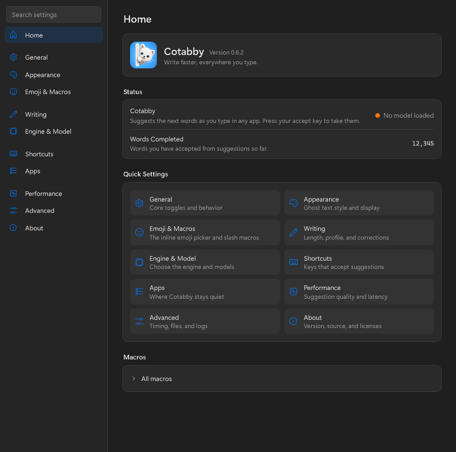
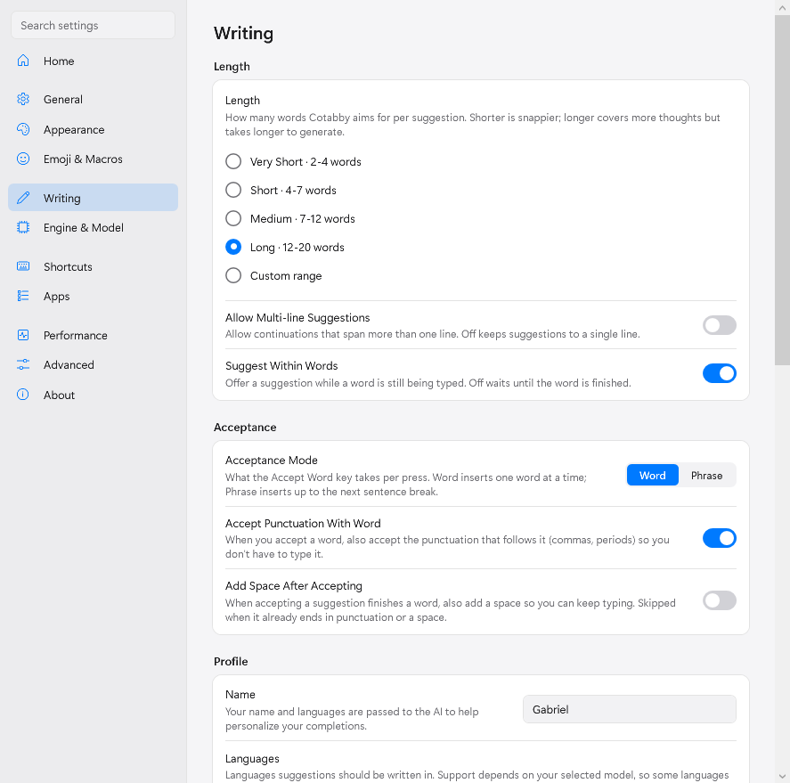
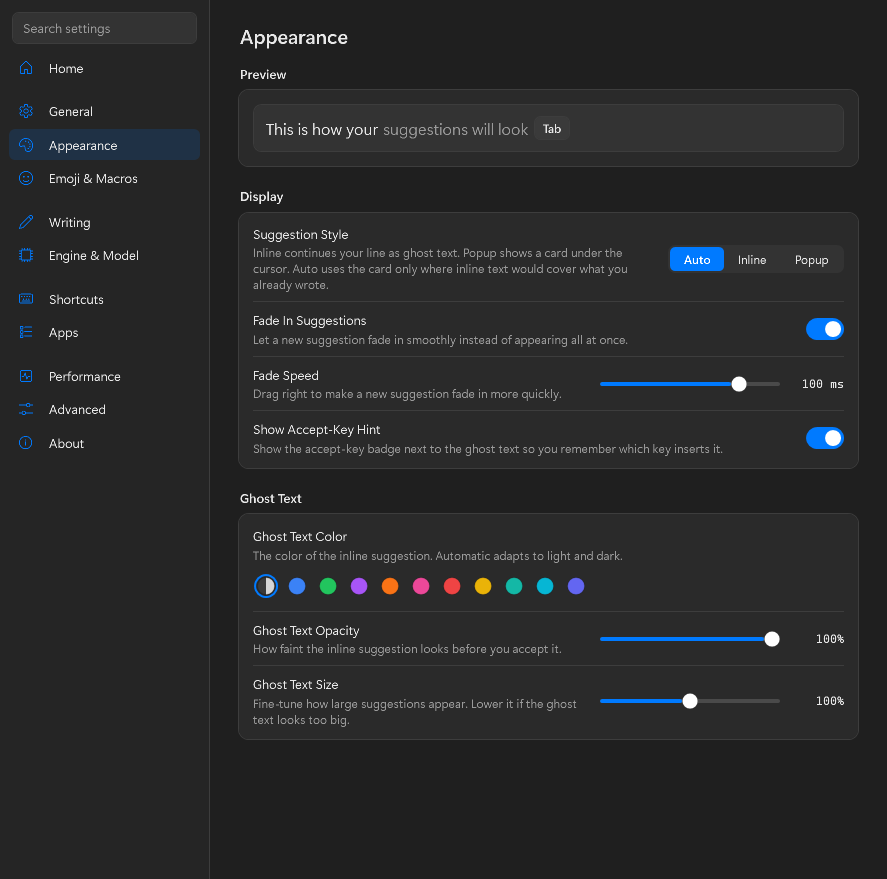
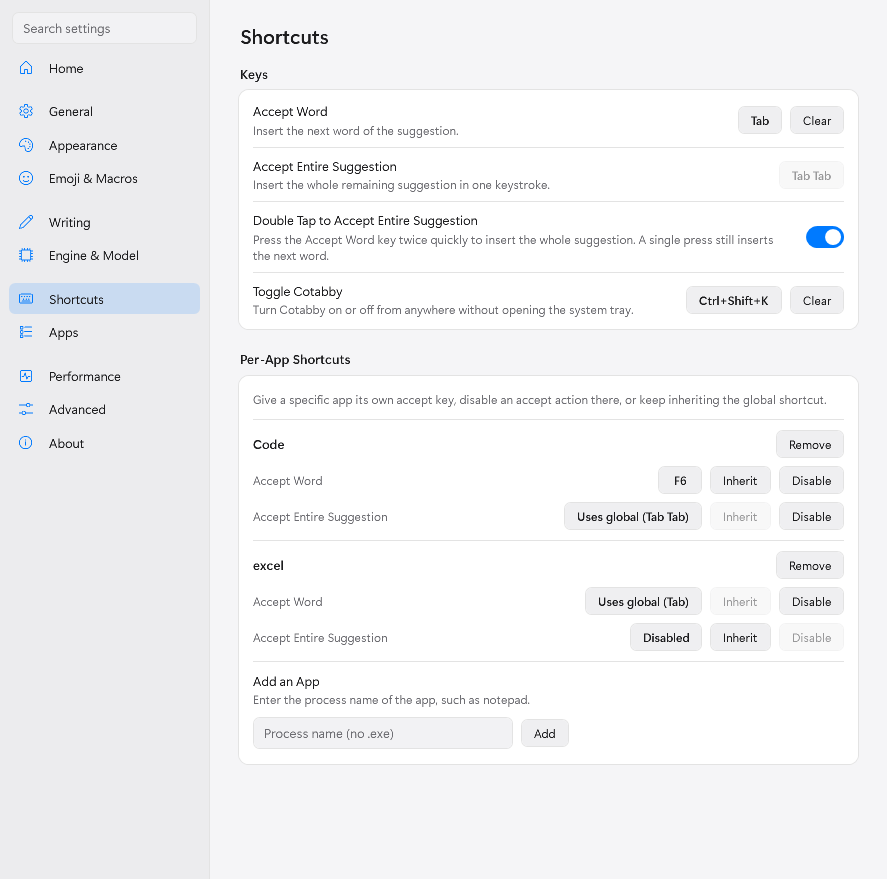
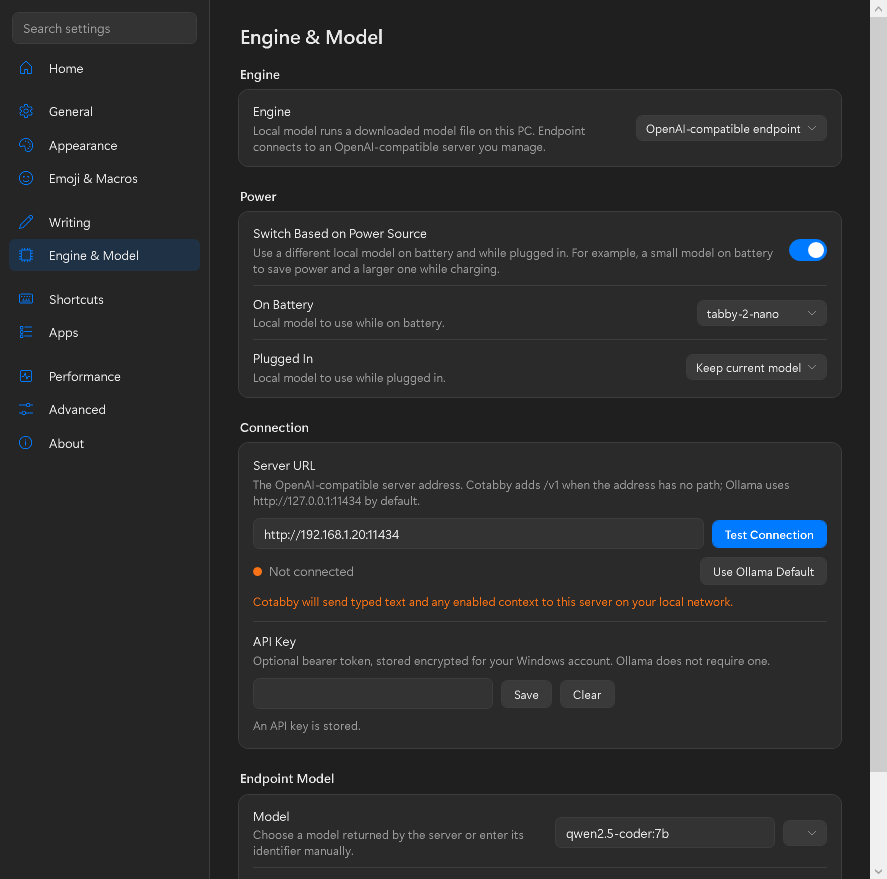
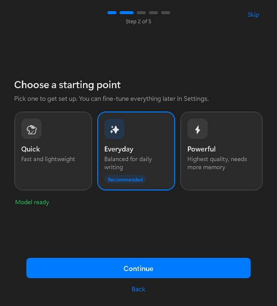
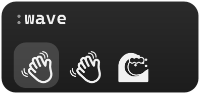

<p align="center">
  
</p>

<h1 align="center">Cotabby for Windows</h1>

<p align="center"><em>Open-source, local-first AI autocomplete for Windows.</em></p>

<p align="center">
  <a href="LICENSE"></a>
  
  
</p>

<p align="center">
  <sub>A native Windows port of <a href="https://github.com/FuJacob/cotabby">Cotabby</a>, the macOS app by FuJacob and contributors. It follows upstream main as of October 2026 (8cdbea2).</sub>
</p>

---

## What It Does

Cotabby brings AI autocomplete to almost any text field on your PC. As you type, a gray suggestion appears right after your cursor. Press `Tab` to take it one word at a time, or just keep typing and it gets out of the way.

By default a small model runs on your own machine, so there is no account to create and nothing is sent anywhere. If you would rather use a server you run yourself, or a hosted one, an optional OpenAI-compatible engine can connect to it.

<p align="center">
  
</p>

## Features

- **Ghost-text autocomplete** in any field that Windows UI Automation can read. Notepad, browsers, Slack, Outlook, VS Code and most other apps work.
- **Emoji autocomplete.** Type `:wave` and pick an emoji with `Tab`, the arrow keys or a closing colon.
- **Inline macros.** Type `/` for quick math, unit and currency conversion, dates and random values.
- **One-key autocorrect.** A misspelled word shows its fix in green, and a single keypress applies it.
- **Prediction controls.** Choose how long suggestions are, whether they may finish a word you have started, and whether they may run onto the next line.
- **Optional context.** Your name, your languages, a few notes about you, the app you are in, text you just copied and the text on screen around the field can each shape a suggestion, and each has its own switch.
- **Streaming and input methods.** You can watch a suggestion appear word by word while it generates. Cotabby holds back while a Japanese, Chinese or Korean input method is composing.
- **A suggestion that comes back.** Backspace over a typo, or retype what was suggested, and the earlier suggestion returns at once without asking the model again.
- **Rebindable shortcuts** with per-app overrides, a double tap to accept everything, and a global on/off key.
- **Pause when you want.** Pause for a while from the tray, turn Cotabby off in particular apps, or let battery saver or Energy Saver pause it for you.

<div align="center">

|  |  |
|:---:|:---:|
|  |  |
|  |  |

</div>

<p align="center">
  
  &nbsp;&nbsp;
  
</p>

## Privacy

Privacy is the whole point, so the default engine keeps everything on your PC.

- The local engine runs entirely on your machine.
- The optional OpenAI-compatible engine sends a bounded request only to the endpoint you set up. That endpoint can be on this PC, on your local network, or a public HTTPS service. Text after your cursor is never sent to it.
- There are no analytics, no telemetry and no crash reports.
- Screen context reads the window around the field with the Windows OCR engine on your PC. The pixels are thrown away once they are read, and nothing is saved. With an endpoint selected, only a short excerpt from just above the field is sent. Cotabby keeps its own suggestion out of screen capture, so it never reads itself back, and while screen context is on the suggestion also stays out of screenshots and screen shares.
- Text that a password manager marks as private when you copy it is never used as context. When Cotabby pastes a long suggestion for you, it puts your clipboard back the way it was.
- Cotabby stays out of password fields, sign-in and verification fields, and terminals. It recognizes password fields labelled in more than twenty languages.
- A normal install never writes what you type to disk. The log keeps timings and counts. Verbose logging that includes text is something you turn on yourself with the `COTABBY_DEBUG_LOG=1` environment variable.
- While Cotabby is turned off or paused, it stops watching which field has focus.
- Apart from a configured endpoint, the network is only used to download models.

## Engines

Pick the engine in Settings, under Engine & Model.

- **Local model.** A small model you download once and run on your PC through [llama.cpp](https://github.com/ggerganov/llama.cpp). It uses your GPU through Vulkan when there is one, and falls back to the CPU when the GPU cannot hold the model.
- **OpenAI-compatible.** A completion or chat endpoint you set up, such as a local Ollama server, another machine on your network, or a public HTTPS service. The API key is stored encrypted for your Windows account.

| Model        | Size    | Good for                                   |
| ------------ | ------- | ------------------------------------------ |
| Cotabby Nano | ~0.6 GB | Older or low-memory PCs, and the fastest   |
| Cotabby Mini | ~1.3 GB | A solid everyday balance, and the default  |
| Cotabby Base | ~3.9 GB | Higher-quality suggestions                 |
| Cotabby Pro  | ~5.3 GB | The best quality, with 16 GB of memory     |

Cotabby can also switch between two local models depending on whether the PC is plugged in.

<details>
<summary><strong>Advanced</strong> model files, your own models, and how generation works</summary>

<br />

The local engine runs GGUF *base* models. Rather than prompting an instruction-tuned chat model, Cotabby treats the model as a plain text continuer and conditions it on your name, your languages and the context around the cursor. These are the same files the macOS app uses.

| Model          | File                             | Source |
| -------------- | -------------------------------- | ------ |
| `tabby-2-nano` | `Qwen3.5-0.8B-Base.i1-Q6_K.gguf` | [Hugging Face](https://huggingface.co/mradermacher/Qwen3.5-0.8B-Base-i1-GGUF) |
| `tabby-2-mini` | `Qwen3.5-2B-Base.i1-Q4_K_M.gguf` | [Hugging Face](https://huggingface.co/mradermacher/Qwen3.5-2B-Base-i1-GGUF) |
| `tabby-2-base` | `gemma-4-E2B.i1-Q6_K.gguf`       | [Hugging Face](https://huggingface.co/mradermacher/gemma-4-E2B-i1-GGUF) |
| `tabby-2-pro`  | `gemma-4-E4B.i1-Q4_K_M.gguf`     | [Hugging Face](https://huggingface.co/mradermacher/gemma-4-E4B-i1-GGUF) |

Between keystrokes the model keeps the start of the prompt it has already read, so each new letter only costs the few tokens that changed. The Qwen models mix attention with a recurrent memory that cannot simply be rewound, so for them Cotabby saves a small checkpoint near the end of the prompt and restores it, the way upstream does. In a long document the prompt window moves in larger steps rather than one character at a time, which keeps that saved work useful as you type.

**Bring your own model.** Drop any `.gguf` file into `%LOCALAPPDATA%\Cotabby\models` and it shows up in the model list. Base models work best. Set `COTABBY_MODELS_DIR` to keep models somewhere else.

</details>

## Using Cotabby

Start typing in almost any text field. When a gray suggestion appears, you have three choices.

| Key                    | What it does                                  |
| ---------------------- | --------------------------------------------- |
| `Tab`                  | Accept the next word, or the next phrase if you prefer that mode |
| `` ` `` (backtick)     | Accept the whole suggestion                   |
| `Esc`, `Enter`, or keep typing | Dismiss it                            |

Every shortcut can be changed under Settings, Shortcuts. Cotabby lives in the system tray. Left click the icon to open Settings, and right click it to pause, switch models or quit.

## Install

There is no installer yet, so Cotabby runs from source. You need Windows 10 version 2004 or later on an x64 PC, and the [.NET 9 SDK](https://dotnet.microsoft.com/download).

```powershell
git clone https://github.com/Msde-7/cotabby-windows.git
cd cotabby-windows
dotnet run --project src\Cotabby.App -c Release
```

The first launch opens a short setup that helps you pick a model and downloads it.

Cotabby asks for no special permissions. Reading the focused field, watching the keyboard and typing for you all work under a normal user account, so no administrator rights are needed. The one catch is that apps running as administrator, such as Task Manager, keep their text from normal processes, so Cotabby cannot suggest there.

Settings live in `%APPDATA%\Cotabby\settings.json`, models in `%LOCALAPPDATA%\Cotabby\models`, and the log in `%LOCALAPPDATA%\Cotabby\logs`.

## How the port maps to the macOS app

| Concern                 | macOS                      | Windows                                   |
| ----------------------- | -------------------------- | ----------------------------------------- |
| UI                      | SwiftUI and AppKit         | WPF                                       |
| Reading the focused field | Accessibility API        | UI Automation                             |
| Global keyboard         | `CGEventTap`               | Low-level keyboard hook                   |
| Inserting text          | `CGEvent`                  | `SendInput`, with a clipboard paste for long text |
| Local inference         | llama.cpp with Metal       | llama.cpp with Vulkan through LLamaSharp  |
| Spell checking          | `NSSpellChecker` and SymSpell | Windows spell checker and SymSpell     |
| Secret storage          | Keychain                   | DPAPI                                     |
| Menu bar                | `NSStatusItem`             | System tray                               |

### Parity with upstream

| Area | Status |
| --- | --- |
| Base-model prompt pipeline, token budgeting, token healing, decode stops | Ported |
| Output cleanup, seam guard, live spacing, dismissal memory, local word endings | Ported |
| One word at a time with the following words kept ready, and a pause matched to your typing rhythm | Ported |
| Predict-ahead while typing, with the next suggestion prefetched as the current one runs out and started as soon as the last word is accepted | Ported |
| Recent suggestions brought back after Backspace or retyping | Ported |
| Word and phrase acceptance, CJK chunking, trailing space, double tap | Ported |
| Which keys ask for a new suggestion, with Enter and most shortcuts dismissing it | Ported |
| Rebindable shortcuts, per-app overrides, global toggle | Ported |
| Inline ghost text over up to six rows, cut to one row when text follows, and a card under the caret otherwise | Ported |
| Ghost text in the host's font and size, wrapped inside the field, with Electron editors woken | Ported |
| Suggestions kept to the conversation they were made for, and refreshed when the text on screen changes | Ported |
| Emoji picker with skin tone, gender, recents and popularity | Ported |
| Slash macros | Ported |
| Autocorrect with seven bundled dictionaries | Ported |
| OpenAI-compatible endpoint engine, with streamed partial suggestions | Ported |
| Clipboard, app and extended context | Ported |
| Pause controls, per-app disable, battery saver and Energy Saver pause, terminal and sign-in exclusions | Ported |
| Quiet while Gmail shows its own Smart Compose suggestion | Ported |
| Power-based model switching, your own GGUF models | Ported |
| Searchable settings, first-run setup, performance pane with live CPU, memory and GPU graphs | Ported |
| Performance tracking toggle and recent request log | Ported |
| Opt-in typing history with Cotypist import, encrypted with AES-GCM under a DPAPI key | Ported |
| Screen context through OCR, with Windows.Media.Ocr in place of Vision | Ported |
| Streaming partial suggestions on screen, next-word prefetch behind a word ending or a spelling fix | Ported |
| Prompt prewarm when a field gains focus, and prompt checkpoints for hybrid models | Ported |
| Holding back while an input method composes text | Ported. Windows keeps another app's composition private, so the hold follows the input method's mode and the keys each language commits with |
| Apple Intelligence engine | Not applicable on Windows |
| Field indicator, Hugging Face model browser, live preview field in Settings | Not ported yet |
| Per-domain disable (a hidden option upstream), automatic updates (needs an installer) | Not ported |

## Local Development

```powershell
dotnet build Cotabby.sln
dotnet test Cotabby.sln
```

```
src/
  Cotabby.Core/        Pure logic. Suggestion pipeline, prompt and output policies, emoji, macros, spelling.
  Cotabby.Inference/   The llama.cpp engine, the endpoint engine and model downloads.
  Cotabby.Win32/       UI Automation, keyboard hook, text insertion, clipboard and other Windows interop.
  Cotabby.App/         The WPF tray app, overlay, settings and first-run setup.
tests/                 xUnit tests, most of them ported from upstream.
tools/                 Smoke tools for checking the real thing by hand.
```

`Cotabby.Core` has no Windows dependency, which is what keeps most of the behavior testable. Shared build settings live in `Directory.Build.props`, package versions in `Directory.Packages.props`, and warnings fail the build.

A few tests need something the build machine may not have, so they are skipped unless you opt in. Set `COTABBY_TEST_MODEL_PATH` to a downloaded `.gguf` file to run the model-backed runtime tests on the CPU, and set `COTABBY_CLIPBOARD_TEST=1` to run the test that uses the real clipboard.

| Tool | What it checks |
| --- | --- |
| `tools\Cotabby.Tools.InferenceSmoke` | One generation with the downloaded model |
| `tools\Cotabby.Tools.CoordinatorSmoke` | A typing session through the real pipeline, with a faked keyboard and field |
| `tools\Cotabby.Tools.AppSmoke` | The running app against a real Notepad window. It types for you, so run it while the PC is idle |

## Contributing

Issues and pull requests are welcome. Behavior should match upstream unless Windows needs something different, and most tests are ported from upstream for exactly that reason, so a change that breaks one deserves a close look.

## Acknowledgments

- [Cotabby](https://github.com/FuJacob/cotabby) by FuJacob, jam-cai and akramj13. The design, the pipeline and most of the tests come from their work.
- [llama.cpp](https://github.com/ggerganov/llama.cpp) and [LLamaSharp](https://github.com/SciSharp/LLamaSharp) for local inference.
- [H.NotifyIcon](https://github.com/HavenDV/H.NotifyIcon) for the tray icon.
- [GitHub gemoji](https://github.com/github/gemoji) and Hugging Face for the emoji data and the downloadable models.
- [SymSpell](https://github.com/wolfgarbe/SymSpell) by Wolf Garbe for autocorrect. The frequency dictionaries come from [Google Ngrams](https://books.google.com/ngrams) and licensed SCOWL and Hunspell word lists.

## License

Cotabby for Windows is licensed under the [GNU Affero General Public License v3.0](LICENSE), the same license as upstream. You can use, study, change and share the app. If you distribute a modified version, or make one available to people over a network, you must provide its source code under the same license.

Third-party dependencies, emoji data and downloadable model weights keep their own licenses. Bundled notices are reproduced in [THIRD_PARTY_LICENSES.md](THIRD_PARTY_LICENSES.md).
